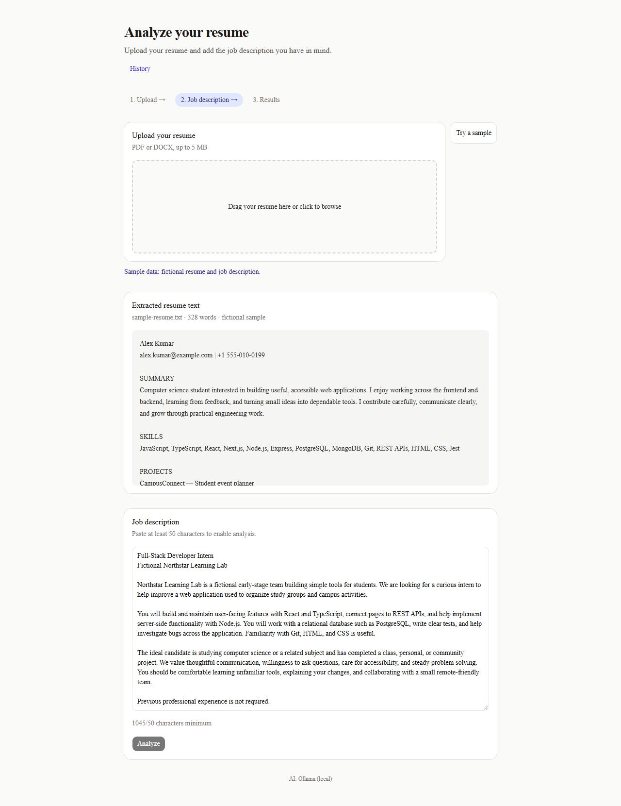
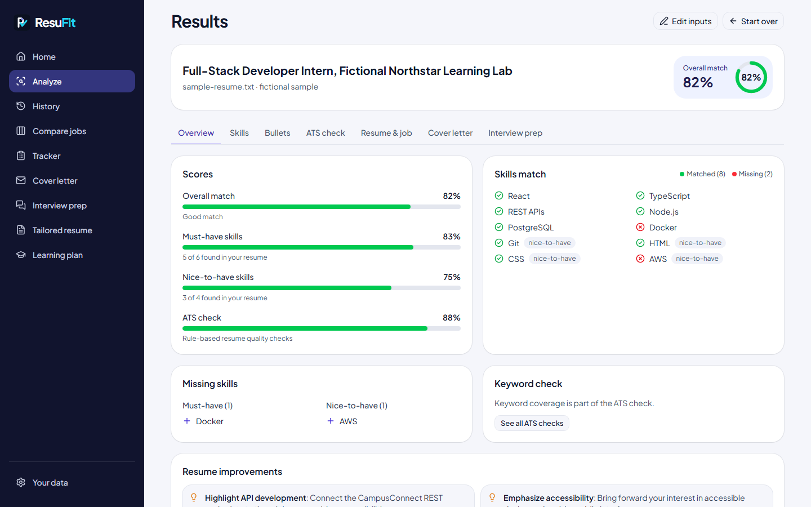
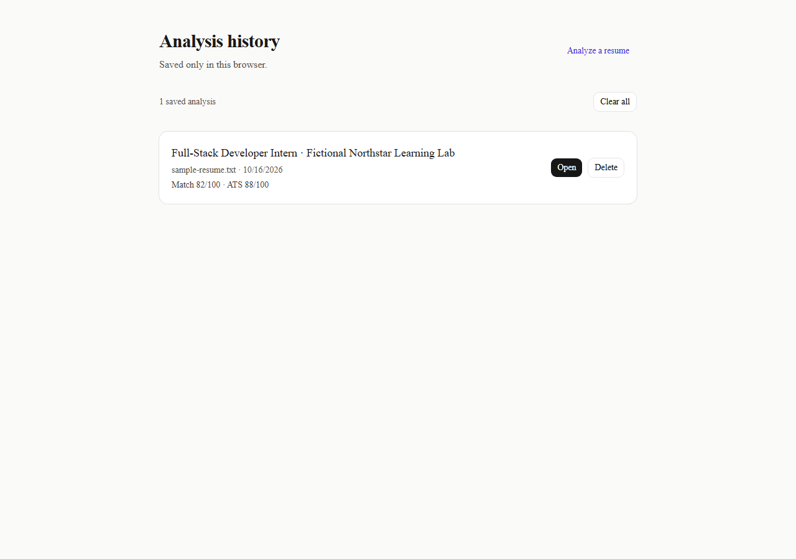
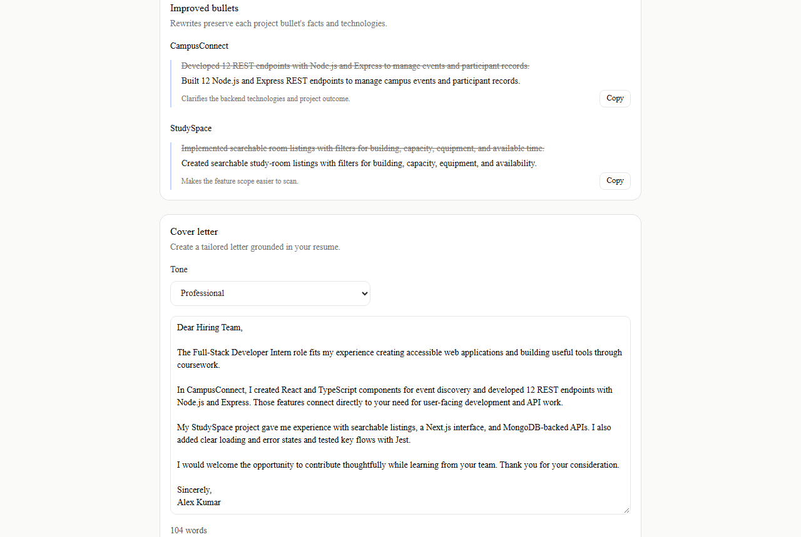

# ResuFit

ResuFit compares a resume with a job description and gives an honest match score, ATS checks, suggestions, and bullet rewrites.

[Live demo](https://resufit-one.vercel.app) · [](https://github.com/danushri-p/resufit/actions/workflows/ci.yml)

## Screenshots









## Features

- Upload and preview PDF or DOCX resumes (up to 5 MB), or try fictional sample data.
- Compare resume skills and experience against a job with a deterministic match score.
- Compare one resume against up to three jobs, ranked by match, with shared skill gaps.
- Review tailored suggestions and ATS checks.
- Rewrite project bullets with checks against unsupported facts and technologies.
- Generate a tailored, editable cover letter using only resume facts.
- Prepare for interviews with resume-grounded questions and answer outlines.
- Download a Markdown report.
- Keep up to ten recent analyses in browser-local history.
- Track job applications (status, applied and follow-up dates, notes, job link) with a response rate and follow-ups due, export them as CSV, and link each one back to its analysis. Stored only in this browser; uses no AI requests.
- Install ResuFit as an app on desktop or phone (Install app button in supported browsers, or Add to Home Screen on iOS). The tracker and history keep working offline; AI features need a connection and AI requests are never cached.
- Back up all saved data to a JSON file and restore it on another browser or device (merge or replace), or delete everything in one step, on the Your data page. Add tracker follow-up dates to any calendar app as an `.ics` file.

## Privacy

Your resume is sent to the AI provider to generate the analysis and is not stored by ResuFit. On the live site the provider is Google Gemini; on the free tier Google may use submitted content to improve its products, so avoid uploading information you don't want to share. Saved history and tracked applications stay in this browser; use the Your data page (`/data`) to back them up, restore them, or delete them. Backup files can include details from your resume, so keep them private.

## How it works

`upload → extract → match → suggest → rewrite`

Resume and job details are extracted by the selected AI provider and validated with Zod. Skill/experience scoring and ATS checks are deterministic; suggestions and rewrites use AI.

## Tech stack

Next.js, TypeScript, Tailwind CSS, Zod, Vitest, Playwright, axe-core, Ollama or Google Gemini, `pdf-parse`, and `mammoth`.

## Honesty safeguards

- **Number guard:** rejects rewrite metrics/numbers that are not supported by the original bullet.
- **Missing-skill guard:** rejects rewrites and suggestions that claim a skill listed as missing, except when a rewrite retains a claim already present in its original bullet.
- **Technology guard:** limits rewritten technologies to those already named in the bullet or project tech stack.
- **Cover-letter guard:** checks unsupported numbers, missing skills, and project/company names; inaccurate paragraphs are retried or removed.
- **Interview-prep guard:** checks unsupported numbers and missing-skill claims, and clears any project or experience reference that is not in the resume.
- **Deterministic results:** match score and ATS checks are rule-based and do not use AI.

## Run locally

Install dependencies with `npm ci`. For local Ollama, install Ollama and run:

```bash
ollama run llama3.2
npm run dev
```

For Gemini, create a key in [Google AI Studio](https://aistudio.google.com/apikey) and set `AI_PROVIDER=gemini` and `GEMINI_API_KEY` in `.env.local`. The default model is `gemini-2.5-flash`; if it is rate limited, ResuFit tries the configured fallback models (default: `gemini-flash-lite-latest,gemini-3.5-flash-lite`). Google retires model names over time, so the `-latest` alias is used for the fallback.

Open [http://localhost:3000](http://localhost:3000). Copy `.env.example` to `.env.local` to customize settings.

### Environment variables

| Variable | Default | Purpose |
| --- | --- | --- |
| `AI_PROVIDER` | `ollama` | Select `ollama` or `gemini`. |
| `OLLAMA_BASE_URL` | `http://127.0.0.1:11434` | Local Ollama server URL. |
| `OLLAMA_MODEL` | `llama3.2` | Local Ollama model. |
| `GEMINI_API_KEY` | *(empty)* | Required when using Gemini; keep secret. |
| `GEMINI_MODEL` | `gemini-2.5-flash` | Gemini model. |
| `GEMINI_FALLBACK_MODELS` | `gemini-flash-lite-latest,gemini-3.5-flash-lite` | Comma-separated Gemini models tried when the primary model hits a rate limit; Google retires model names over time, so the `-latest` alias is included. |
| `NEXT_PUBLIC_AI_PROVIDER_LABEL` | `Ollama (local)` | Non-secret provider label shown in the footer. |

## Testing

```bash
npm run lint
npm test
npm run build
npm run e2e
```

Unit tests use Vitest. End-to-end tests use Playwright with Chromium and axe-core
accessibility scans. The browser tests mock `/api/extract`, `/api/analyze`,
`/api/rewrite`, `/api/cover-letter`, and `/api/interview-prep`; `/api/resume` remains real so the checked-in
PDF and DOCX fixtures exercise document parsing without contacting an AI provider.
The fixtures are generated from `lib/samples.ts` with
`python e2e/generate-fixtures.py`.

Regenerate the README screenshots with:

```bash
npm run screenshots
```

The screenshots spec captures the sample flow at 1280px wide. CI runs validation
and end-to-end tests on Node.js 24 without AI-provider secrets.

## Deploy to Vercel

Import the GitHub repository in Vercel, set `AI_PROVIDER=gemini` and `GEMINI_API_KEY` in project environment variables, optionally set `GEMINI_FALLBACK_MODELS` and `NEXT_PUBLIC_AI_PROVIDER_LABEL=Gemini`, and deploy. Analyze normally uses 2 Gemini requests (one combined resume/job extraction and one suggestions request); Improve bullets, Write cover letter, and Prepare for interview normally use 1 each. A rate-limit fallback can add model requests. Never expose the API key with a `NEXT_PUBLIC_` prefix.

## Limitations

- The free Gemini tier has rate limits per Google project. Fallback models have their own model quotas, but all models still share the project's overall limits. Use different keys/projects for local testing and the live site if both are used heavily.
- Compare jobs normally uses 1 AI request for resume extraction plus 1 per job description (3–4 total for 2–3 jobs), or 0 additional requests when each extraction is cached.
- Analyze normally uses 2 Gemini requests (combined resume/job extraction and suggestions); Improve bullets normally uses 1. A rate-limit fallback can add model requests. ResuFit caches successful AI results in memory for up to one hour per serverless instance, so cache hits are not shared between instances.
- Write cover letter normally uses 1 AI request, or 0 when the result is cached. Google retires model names over time, so the configured fallback includes the `gemini-flash-lite-latest` alias.
- Prepare for interview normally uses 1 AI request, or 0 when the result is cached. Interview outlines are suggestions for practice, not scripts; answer in your own words.
- The app also uses a basic in-memory per-IP request limit.
- Small local models may be less accurate than hosted models.
- Scanned/image-only PDFs are not supported; the PDF must contain selectable text.
- Analysis history and tracked applications are stored per browser and are not shared across browsers or devices. Clearing site data deletes them; use Export CSV to keep a copy of your applications.
- Offline support caches only the home page, tracker, history, and pages you have opened. Regenerate the install icons with `node scripts/generate-pwa-icons.mjs` after changing `public/logo.svg`, and bump `CACHE_VERSION` in `public/sw.js` when the caching rules change.

## Project timeline

- **Day 1:** Set up the app and resume upload/preview flow.
- **Day 2:** Extract structured resume and job details.
- **Day 3:** Add match scoring and suggestions.
- **Day 4:** Add guarded bullet rewrites and Markdown reports.
- **Day 5:** Add ATS checks and browser-local history.
- **Day 6:** Add Gemini, deployment configuration, and public-site safeguards.
- **Day 7:** Polish sample flow, landing page, error states, metadata, and CI.
- **Day 8:** Add honest, tailored cover letter generation.
- **Day 9:** Add Playwright end-to-end tests, axe accessibility checks, and generated README screenshots.
- **Day 10:** Add honest interview preparation with guarded, resume-based answer outlines.
- **Day 11:** Compare one resume against up to three jobs and identify shared skill gaps.
- **Day 12:** Track job applications with statuses, follow-up reminders, CSV export, and links back to saved analyses.
- **Day 13:** Make ResuFit an installable app (web app manifest, app icons, service worker) with offline support for the tracker and history.
- **Day 14:** Back up, restore, and delete all browser-stored data, and export follow-up reminders to calendar apps.
