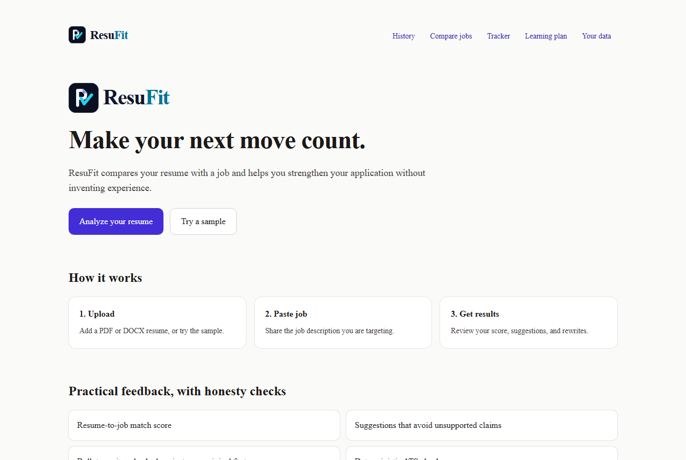
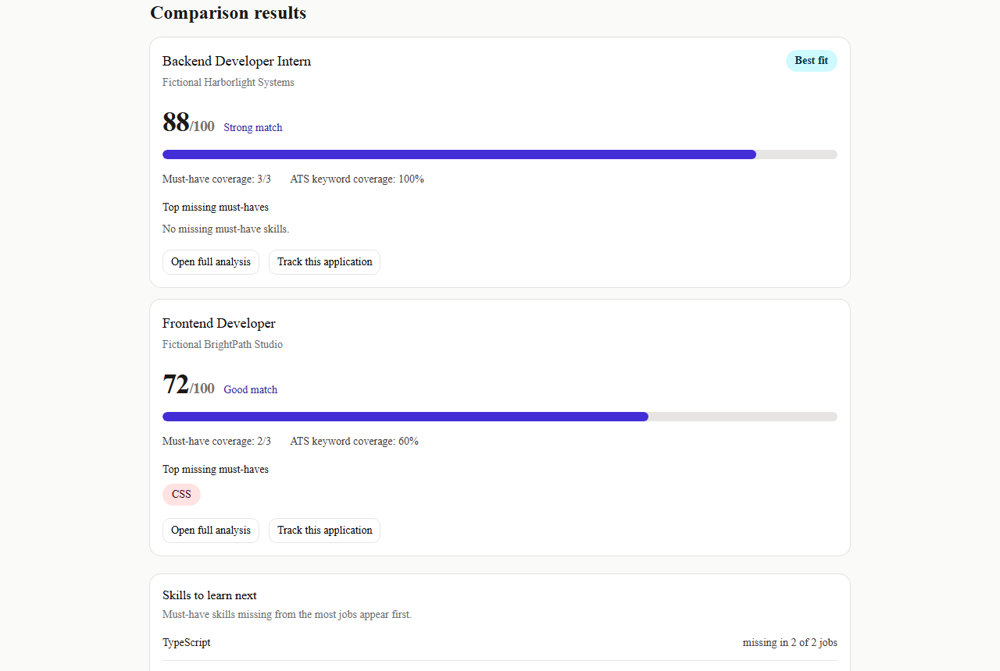
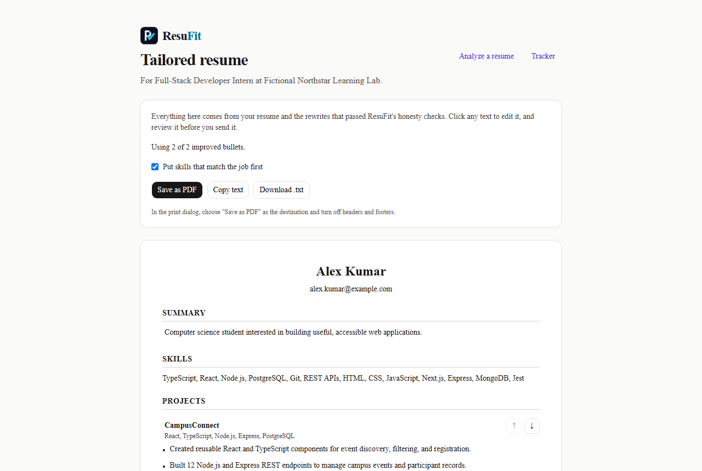
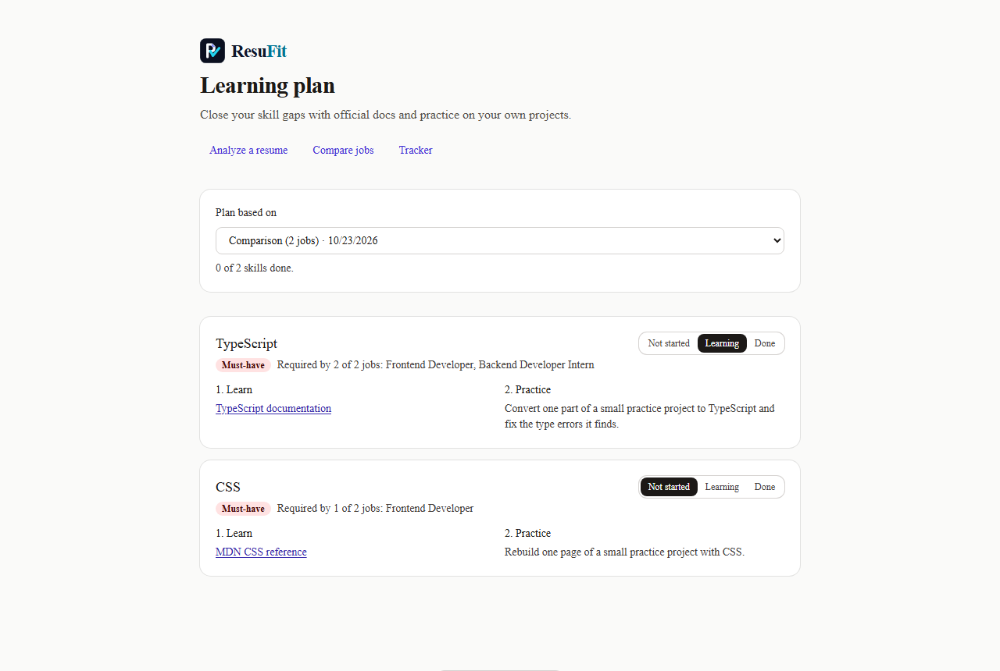
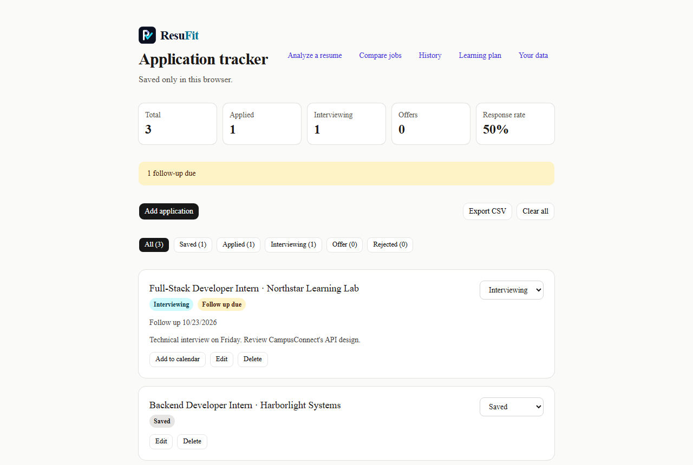
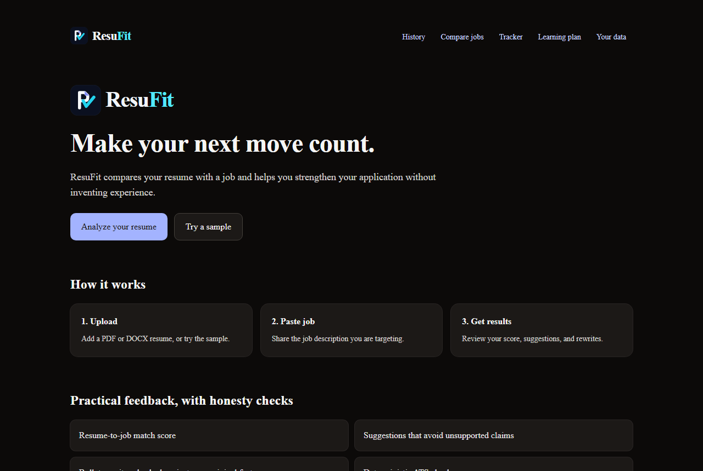

# ResuFit

ResuFit compares your resume with a job description and helps you improve your application honestly: a deterministic match score and ATS check, suggestions and bullet rewrites that never invent experience, a tailored resume, cover letter, interview prep, a learning plan for skill gaps, and an application tracker.

[Live demo](https://resufit-one.vercel.app) · [](https://github.com/danushri-p/resufit/actions/workflows/ci.yml)

## Screenshots



<table>
  <tr>
    <td width="50%"><br><sub>Match analysis and suggestions</sub></td>
    <td width="50%"><br><sub>Compare jobs</sub></td>
  </tr>
  <tr>
    <td><br><sub>Tailored resume builder</sub></td>
    <td><br><sub>Cover letter</sub></td>
  </tr>
  <tr>
    <td><br><sub>Learning plan</sub></td>
    <td><br><sub>Application tracker</sub></td>
  </tr>
  <tr>
    <td colspan="2"><br><sub>Dark mode</sub></td>
  </tr>
</table>

Screenshots use the fictional sample resume and jobs, with AI responses mocked.

## Features

### Analyze
- Upload a PDF or DOCX resume (up to 5 MB), or try fictional sample data.
- Deterministic match score against a job, with matched and missing must-have and nice-to-have skills.
- Rule-based ATS check: contact details, section headings, length, job keywords, action verbs, and measurable results.
- Compare one resume against up to three jobs, ranked by match, with the skill gaps they share.

### Improve
- Suggestions and project-bullet rewrites with honesty checks (see below).
- Tailored, ATS-friendly one-column resume: choose original or improved wording per bullet, reorder projects, put job-matching skills first, edit any text, then save as PDF (browser print) or copy/download text.
- Editable cover letter that uses only facts from your resume.
- Interview prep with resume-grounded questions, answer outlines, and a practice mode.
- Learning plan for missing skills: curated, link-checked official documentation and a practice project based on your own resume, with Not started / Learning / Done progress.

### Apply
- Application tracker: status, applied and follow-up dates, notes, and job link; response rate and follow-ups due; CSV export; add follow-ups to any calendar app (`.ics`); links back to the saved analysis.
- Markdown report for an analysis or comparison.

### Your data and the app
- History of the ten most recent analyses and comparisons.
- Your data page (`/data`): back up everything to a JSON file, restore it on another browser or device (merge or replace), or delete everything at once.
- Installable app (manifest, icons, service worker). Home, tracker, history, data, and learning plan work offline; AI features need a connection, and AI requests are never cached.
- Light, dark, or system theme, applied before the page paints. Printed resumes always stay light.

## Privacy

Your resume is sent to the AI provider to generate the analysis and is not stored by ResuFit. On the live site the provider is Google Gemini; on the free tier Google may use submitted content to improve its products, so avoid uploading information you don't want to share.

Saved analyses, tracked applications, and learning progress stay in this browser. Use the Your data page to back them up, restore them, or delete them. Backup files can include details from your resume, so keep them private.

## How it works

`upload → extract (AI) → match and ATS check (rules) → suggest and rewrite (AI, guarded) → tailored resume, cover letter, interview prep → track and learn`

Resume and job details are extracted by the selected AI provider and validated with Zod. Match scores and ATS checks are deterministic. Generated text passes through the honesty safeguards before it is shown.

## Honesty safeguards

- **Number guard:** rejects metrics or numbers that are not supported by the original resume text, and rewrites that drop real numbers.
- **Missing-skill guard:** rejects rewrites and suggestions that claim a skill listed as missing, except when the original bullet already claims it.
- **Technology guard:** limits rewritten technologies to those already named in the bullet or project tech stack.
- **Cover-letter guard:** checks unsupported numbers, missing skills, and project/company names; inaccurate paragraphs are retried or removed.
- **Interview-prep guard:** checks unsupported numbers and missing-skill claims, and clears any project or experience reference that is not in the resume.
- **Tailored resume:** contains only your resume text and rewrites that passed these checks; skills can be reordered but never added.
- **Deterministic results:** match scores and ATS checks are rule-based and do not use AI.

## Tech stack

Next.js 16 (App Router, Cache Components), TypeScript, Tailwind CSS 4, Zod, Ollama or Google Gemini, `pdf-parse`, `mammoth`, Vitest, Playwright, and axe-core.

## Run locally

Install dependencies with `npm ci`. For local Ollama, install Ollama and run:

```bash
ollama run llama3.2
npm run dev
```

For Gemini, create a key in [Google AI Studio](https://aistudio.google.com/apikey) and set `AI_PROVIDER=gemini` and `GEMINI_API_KEY` in `.env.local`. Copy `.env.example` to `.env.local` to customize settings, then open [http://localhost:3000](http://localhost:3000).

### Environment variables

| Variable | Default | Purpose |
| --- | --- | --- |
| `AI_PROVIDER` | `ollama` | Select `ollama` or `gemini`. |
| `OLLAMA_BASE_URL` | `http://127.0.0.1:11434` | Local Ollama server URL. |
| `OLLAMA_MODEL` | `llama3.2` | Local Ollama model. |
| `GEMINI_API_KEY` | *(empty)* | Required when using Gemini; keep secret. |
| `GEMINI_MODEL` | `gemini-2.5-flash` | Primary Gemini model. |
| `GEMINI_FALLBACK_MODELS` | `gemini-flash-lite-latest,gemini-3.5-flash-lite` | Models tried when the primary model is rate limited, overloaded, or unavailable. Google retires model names over time, so the `-latest` alias is included. |
| `NEXT_PUBLIC_AI_PROVIDER_LABEL` | `Ollama (local)` | Non-secret provider label shown in the footer. |

### AI requests per action

| Action | Requests |
| --- | --- |
| Analyze | 2 (combined resume/job extraction, then suggestions) |
| Compare jobs | 1 for the resume plus 1 per job (3–4 for 2–3 jobs) |
| Improve bullets, Write cover letter, Prepare for interview | 1 each |
| Tailored resume, ATS check, learning plan, tracker, history, backups | 0 |

Successful AI results are cached in memory for up to an hour per serverless instance, so repeating the same request usually costs 0. A fallback to another model can add a request. Each IP address is limited to 10 AI requests per minute.

## Testing

```bash
npm run lint
npm test
npm run build
npm run e2e
```

Unit tests use Vitest. End-to-end tests use Playwright with Chromium and axe-core accessibility scans in light and dark mode, plus 375px mobile-width checks and offline (service worker) tests. The browser tests mock `/api/extract`, `/api/analyze`, `/api/compare`, `/api/rewrite`, `/api/cover-letter`, and `/api/interview-prep`; `/api/resume` stays real, so the checked-in PDF and DOCX fixtures exercise document parsing without an AI provider. The fixtures are generated from `lib/samples.ts` with `python e2e/generate-fixtures.py`.

Regenerate the README screenshots with `npm run screenshots`. CI runs validation and end-to-end tests on Node.js 24 without AI-provider secrets.

## Deploy to Vercel

Import the GitHub repository in Vercel, set `AI_PROVIDER=gemini` and `GEMINI_API_KEY` in the project's environment variables, optionally set `GEMINI_FALLBACK_MODELS` and `NEXT_PUBLIC_AI_PROVIDER_LABEL=Gemini`, and deploy. Never expose the API key with a `NEXT_PUBLIC_` prefix. Environment variable changes apply on the next deployment.

## Maintenance notes

- Regenerate the install icons with `node scripts/generate-pwa-icons.mjs` after changing `public/logo.svg`.
- Bump `CACHE_VERSION` in `public/sw.js` when its caching rules change.
- Dark mode mirrors each Tailwind colour ramp in `app/globals.css` (50 ↔ 950, 100 ↔ 900, …), so palette classes adapt automatically. Prefer palette classes over hard-coded hex colours in new UI.
- Learning plan links come from a curated list in `lib/learningResources.ts`; check that each URL loads when adding one. Skills without a curated link get a clearly labelled web search instead of a guessed URL.
- `npm audit --omit=dev` reports no production vulnerabilities. A high-severity advisory remains in `braces` (pulled in by the shadcn CLI and the Next.js ESLint plugin, development tools only); every published `braces` version is affected, so there is no fixed release to upgrade to yet.

## Limitations

- The free Gemini tier has rate limits per Google project. Fallback models have their own quotas but share the project's overall limits, so use different keys or projects for local testing and the live site if both are used heavily.
- Small local models (Ollama) are less accurate than hosted models.
- Scanned or image-only PDFs are not supported; the PDF must contain selectable text.
- Saved data is stored per browser and is not synced across browsers or devices. Clearing site data deletes it; download a backup from the Your data page to keep a copy.
- Offline support covers the home page, tracker, history, data page, learning plan, and pages you have already opened.
- The tailored resume is kept only for the current browser tab until you print or download it. PDF export uses the browser's print dialog: choose "Save as PDF" and turn off headers and footers.

## Project timeline

- **Day 1:** Set up the app and resume upload/preview flow.
- **Day 2:** Extract structured resume and job details.
- **Day 3:** Add match scoring and suggestions.
- **Day 4:** Add guarded bullet rewrites and Markdown reports.
- **Day 5:** Add ATS checks and browser-local history.
- **Day 6:** Add Gemini, deployment configuration, and public-site safeguards.
- **Day 7:** Polish sample flow, landing page, error states, metadata, and CI.
- **Day 8:** Add honest, tailored cover letter generation.
- **Day 9:** Add Playwright end-to-end tests, axe accessibility checks, and generated README screenshots.
- **Day 10:** Add honest interview preparation with guarded, resume-based answer outlines.
- **Day 11:** Compare one resume against up to three jobs and identify shared skill gaps.
- **Day 12:** Track job applications with statuses, follow-up reminders, CSV export, and links back to saved analyses.
- **Day 13:** Make ResuFit an installable app (web app manifest, app icons, service worker) with offline support.
- **Day 14:** Back up, restore, and delete all browser-stored data, and export follow-up reminders to calendar apps.
- **Day 15:** Build a tailored, ATS-friendly resume from approved rewrites and export it as PDF or text.
- **Day 16:** Add dark mode with a system/light/dark switch, no flash on load, and dark-mode accessibility checks.
- **Day 17:** Add a learning plan for skill gaps with curated official docs, practice projects, and progress tracking.
- **Day 18:** Maintenance: upgrade Vitest to 5 (clearing the critical advisories), keep build-only tools out of production dependencies, fix outline-button borders, and refresh the README and screenshots.
